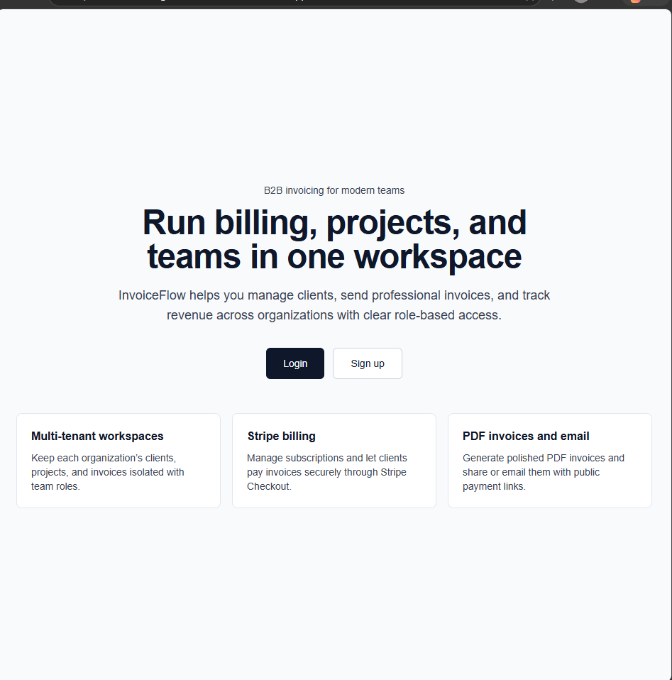
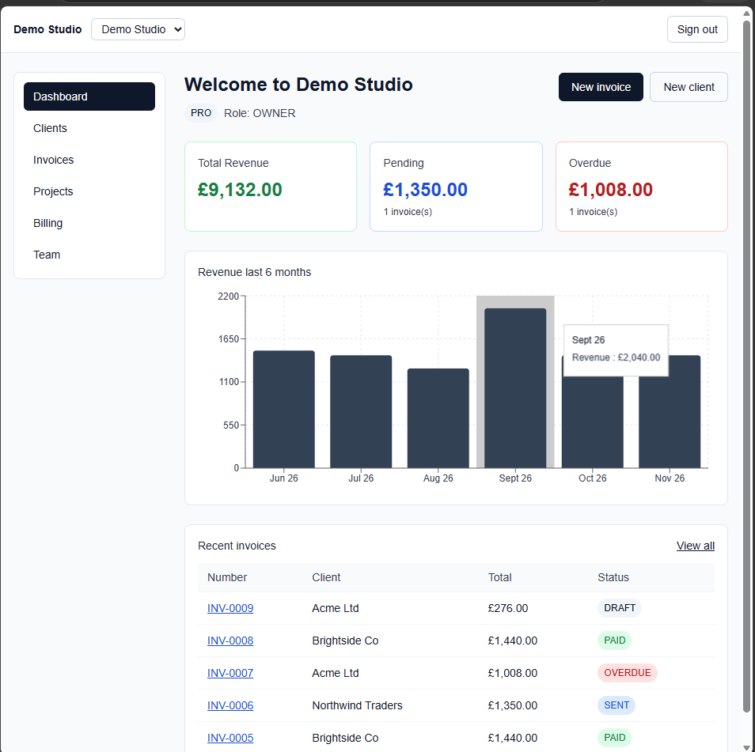
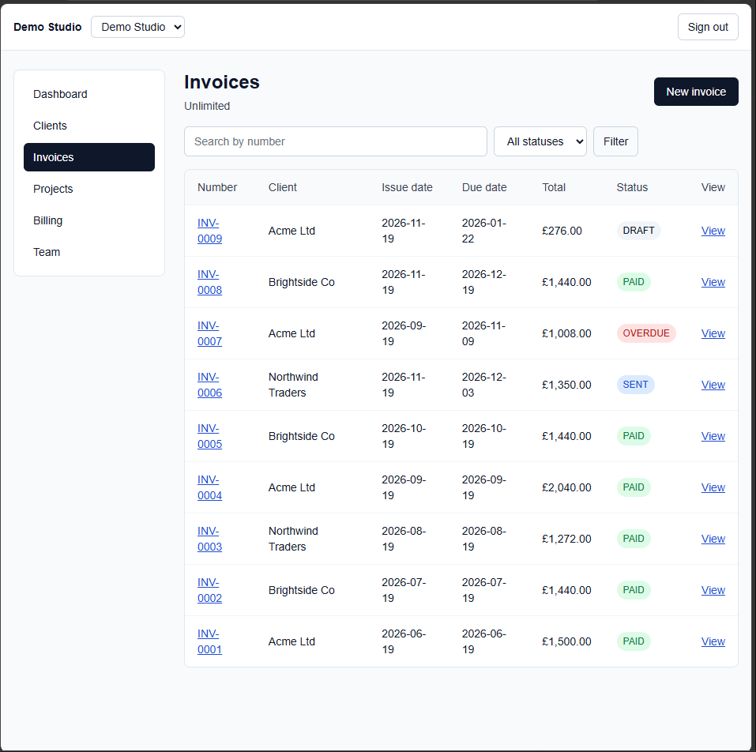
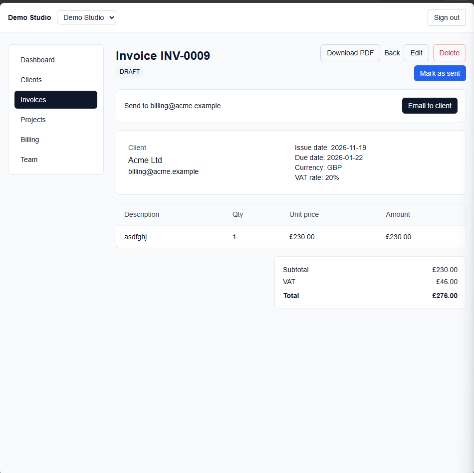
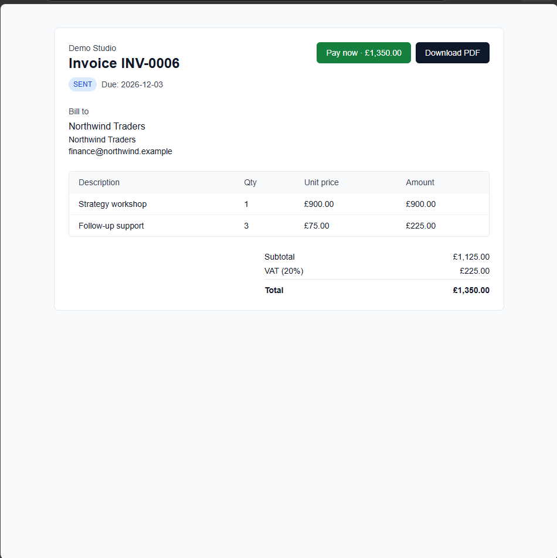
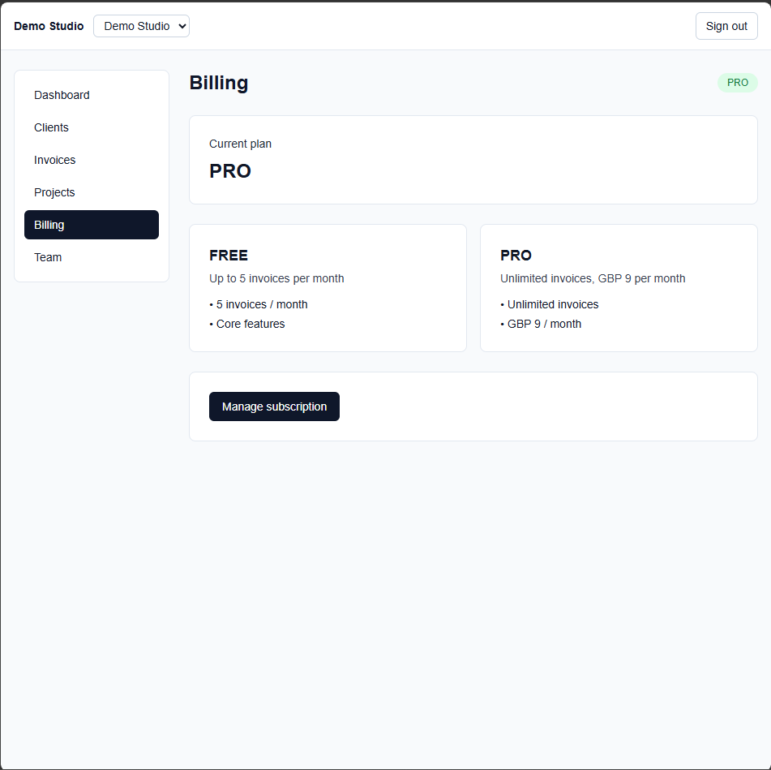
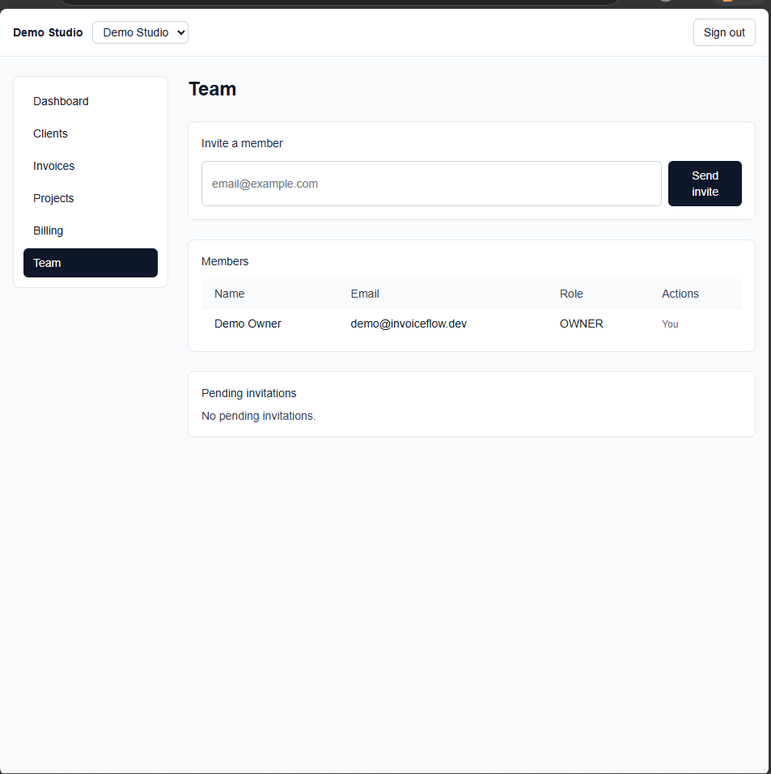
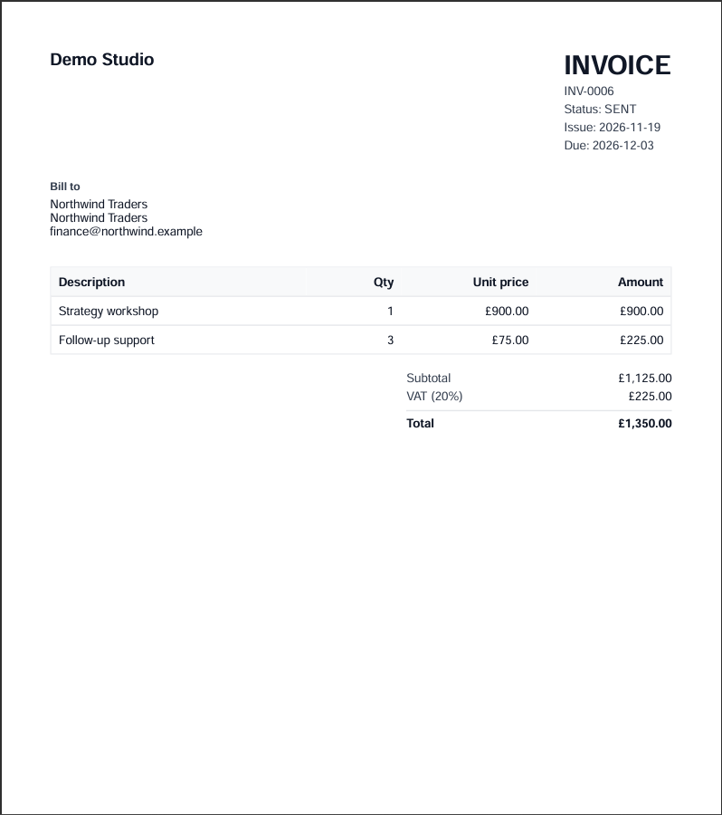
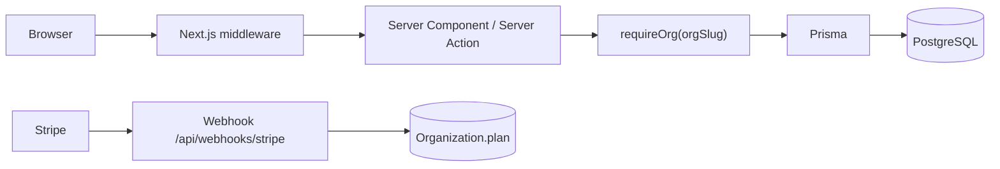
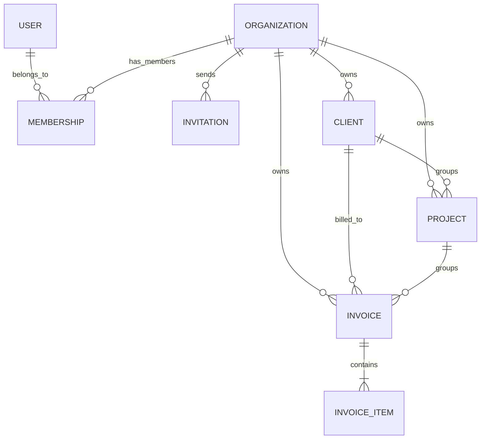

# InvoiceFlow

**A multi-tenant B2B invoicing SaaS — clients, projects, and invoices with PDF delivery, email, and Stripe payments in one workspace.**

[](https://nextjs.org)
[](https://www.typescriptlang.org)
[](https://www.prisma.io)
[](https://neon.tech)
[](https://stripe.com)
[](https://tailwindcss.com)

**Live demo:** https://invoice-saas-one-lyart.vercel.app/

### Demo credentials

| Email | Password |
| --- | --- |
| `demo@invoiceflow.dev` | `Demo12345!` |

The demo workspace is **seeded on demand** and is a `PRO` organization, so it has no invoice limit. Sign in from `/login` using the **Try the demo** button (enabled when `NEXT_PUBLIC_DEMO_ENABLED=true`) or the credentials above.

---

## Screenshots

<table>
  <tr>
    <td width="50%" valign="top">
      <a href="docs/screenshots/01-landing.png"></a>
      <sub><b>Landing</b> — product overview with a direct path into the demo.</sub>
    </td>
    <td width="50%" valign="top">
      <a href="docs/screenshots/02-dashboard.png"></a>
      <sub><b>Dashboard</b> — revenue, pending and overdue KPIs with a six-month revenue chart.</sub>
    </td>
  </tr>
  <tr>
    <td width="50%" valign="top">
      <a href="docs/screenshots/03-invoices.png"></a>
      <sub><b>Invoices</b> — status filtering, monthly FREE-plan usage, and quick links.</sub>
    </td>
    <td width="50%" valign="top">
      <a href="docs/screenshots/04-invoice-detail.png"></a>
      <sub><b>Invoice detail</b> — line items, VAT, totals, and status actions.</sub>
    </td>
  </tr>
  <tr>
    <td width="50%" valign="top">
      <a href="docs/screenshots/05-public-invoice.png"></a>
      <sub><b>Public invoice</b> — tokenized client link with a Stripe Checkout “Pay now” button.</sub>
    </td>
    <td width="50%" valign="top">
      <a href="docs/screenshots/06-billing.png"></a>
      <sub><b>Billing</b> — FREE vs. PRO plans, Stripe Checkout upgrade, and the billing portal.</sub>
    </td>
  </tr>
  <tr>
    <td width="50%" valign="top">
      <a href="docs/screenshots/07-team.png"></a>
      <sub><b>Team</b> — members, roles, and email invitations with revoke support.</sub>
    </td>
    <td width="50%" valign="top">
      <a href="docs/screenshots/08-pdf.png"></a>
      <sub><b>PDF invoice</b> — generated document, downloadable and attached to email.</sub>
    </td>
  </tr>
</table>

---

## Features

**Multi-tenant workspaces**
- Organization-scoped routing via `/{orgSlug}` with an org switcher for users who belong to several workspaces.
- Every record (client, project, invoice, item, invitation) belongs to exactly one organization.

**Roles and access control**
- `OWNER` can do everything: billing, team management, and destructive actions.
- `MEMBER` can create and edit clients, projects, and invoices, and send invoice emails, but cannot delete records or access billing/team management. Enforcement happens in server actions, not just the UI.

**Team invitations**
- Owners invite teammates by email; invitations create `MEMBER`s only.
- Invites expire after 7 days, can be revoked, and are accepted through a public `/invite/{token}` page (create an account or sign in with the invited address).

**Invoicing**
- Clients and projects CRUD; invoices with line items, VAT, and GBP/USD/EUR support.
- Invoice lifecycle: `DRAFT → SENT → PAID`, with `OVERDUE` derived from due dates and synced on read.
- Server-computed subtotal, tax, and total — client-supplied amounts are never trusted.

**Delivery**
- PDF invoice generation with `@react-pdf/renderer`.
- Email delivery of the invoice PDF as an attachment via SMTP.
- Public invoice page with a unique token where clients can pay with Stripe Checkout; the webhook marks the invoice `PAID`.

**Billing**
- FREE vs. PRO subscription plans via Stripe Checkout and the Stripe Billing Portal.
- Webhook-driven plan sync (`Organization.plan`), idempotent event handling, and a 5 invoices/month limit on FREE.

**Dashboard**
- Per-organization KPIs (revenue, pending, overdue), a six-month revenue chart, and recent invoices.
- Currency-aware views that default to the organization’s most-used currency.

---

## Tech stack

| Layer | Technology |
| --- | --- |
| Framework | Next.js 14 (App Router, Server Components, Server Actions) |
| Language | TypeScript |
| Database & ORM | PostgreSQL (Neon) with Prisma |
| Authentication | NextAuth (credentials provider, JWT sessions, bcrypt) |
| Payments | Stripe Checkout, Billing Portal, and signed webhooks |
| UI | Tailwind CSS, Recharts |
| PDF generation | `@react-pdf/renderer` (pdfkit) |
| Email | Nodemailer over SMTP |
| Validation | Zod |
| Hosting | Vercel + Neon Postgres |
| Quality gates | `tsc --noEmit`, ESLint, production `next build` |

---

## Architecture

### Multi-tenancy: shared database, shared schema

InvoiceFlow uses a **shared database with a shared schema**. Every tenant-scoped table carries an `organizationId` foreign key, and the tenant is selected by the `{orgSlug}` segment of the URL. There is no schema-per-tenant and no database-per-tenant.

**Why this model:**

- **Simplest to operate.** One connection string, one schema, one migration path. Adding a tenant is a row insert, not an infrastructure operation.
- **Cost-efficient.** It fits comfortably in Neon’s free tier, where provisioning a database per tenant would not.
- **Easy cross-tenant reporting.** Owner-level analytics and support queries are ordinary SQL rather than N parallel connections.
- **One deploy path.** Schema changes ship once and apply everywhere, instead of being replayed per tenant.

**The trade-off, stated plainly:** isolation is enforced by application code, not by the database. A single query missing an `organizationId` filter would leak data across tenants. That risk is mitigated by making the tenant id non-negotiable: it is always derived server-side from `requireOrg(orgSlug)`, which resolves the user’s `Membership` row for that slug, and it is never read from params, bodies, or query strings for data access. Row-level security in Postgres is the natural next step (see [Future improvements](#future-improvements)).

### Request flow



1. Middleware gates authenticated routes; public routes (`/invoice/[token]`, `/invite/[token]`, `/api/*`) are excluded.
2. Server components and server actions call `requireOrg(orgSlug)`, which verifies the caller’s membership and returns `organizationId`, `organization`, and `role`.
3. Prisma queries are always scoped with that `organizationId`.
4. Stripe webhooks run outside the session entirely: they verify the signature and update `Organization.plan` (or an invoice) using ids taken from signed event metadata.

### Data model



| Model | Purpose |
| --- | --- |
| `User` | Account identity and credentials. |
| `Organization` | Tenant boundary; holds plan and Stripe subscription fields. |
| `Membership` | Join table linking users to organizations with a `Role`. |
| `Invitation` | Pending team invite, scoped to an organization and an email. |
| `Client` / `Project` | Billable entities, both organization-scoped. |
| `Invoice` / `InvoiceItem` | Invoice header (status, currency, totals, public token) and its lines. |

---

## Security and tenant isolation

- **Membership-based tenant resolution.** `requireOrg(orgSlug)` looks up `Membership` for the current session user and the slug. No membership means `404`; no session means redirect to login.
- **Tenant id never comes from the client.** `organizationId` is taken from the resolved membership and used in every `where` clause. Route params and form bodies are used for record ids only, and always together with the tenant id.
- **Server-computed money.** Subtotal, tax, and total are recalculated on the server from validated line items; totals and prices in the request body are ignored.
- **Role checks on the server.** `requireOwner(orgSlug)` protects deletion, billing, and team-management actions. Hiding buttons is cosmetic only.
- **Webhook signature verification.** Every Stripe event is verified with the raw request body and the signing secret; invalid signatures get `400`.
- **Unguessable public links.** Public invoices use a unique `publicToken` rather than a sequential id, and are excluded from search indexing.
- **Drafts are never public.** Both the public invoice page and the public PDF endpoint return `404` for `DRAFT` invoices.
- **Idempotent payment handling.** Invoice payment webhooks update with `status in [SENT, OVERDUE]`, so replays cannot double-apply or resurrect a paid invoice.
- **Passwords and tokens.** Passwords are hashed with bcrypt (cost 12); secrets live in environment variables and are never committed.

---

## Local setup

**Prerequisites:** Node.js 18+, npm, a PostgreSQL database (Neon or local), and optionally the Stripe CLI for webhook testing.

```bash
# 1. Clone
git clone https://github.com/Cleopatra-Jaza/invoice-saas.git
cd invoice-saas

# 2. Install dependencies (runs `prisma generate` via postinstall)
npm install

# 3. Configure environment
cp .env.example .env   # then fill in the values below

# 4. Apply the schema to your database
npx prisma migrate deploy

# 5. (Optional) Seed the demo workspace
npx tsx scripts/seed-demo.ts

# 6. Run the app
npm run dev
```

`npm install` respects `.npmrc` (`legacy-peer-deps=true`), which avoids a transitive peer-dependency conflict between the chart library and Next.

### Environment variables

Names and purpose only — never commit real values.

| Variable | Purpose |
| --- | --- |
| `DATABASE_URL` | Neon **pooled** connection string used by the app. |
| `DIRECT_URL` | Neon **direct** connection string used by Prisma for migrations. |
| `NEXTAUTH_SECRET` | Secret used to sign and encrypt NextAuth sessions. |
| `NEXTAUTH_URL` | Base URL of the app, used for auth callbacks. |
| `STRIPE_SECRET_KEY` | Stripe API secret key (test mode locally). |
| `STRIPE_WEBHOOK_SECRET` | Signing secret for the webhook endpoint. |
| `STRIPE_PRO_PRICE_ID` | Stripe price id for the PRO subscription. |
| `SMTP_HOST` | SMTP server host for invoice and invite email. |
| `SMTP_PORT` | SMTP server port. |
| `SMTP_USER` | SMTP username. |
| `SMTP_PASS` | SMTP password. |
| `EMAIL_FROM` | From address used on outgoing mail. |
| `NEXT_PUBLIC_APP_URL` | Public base URL used in links and Stripe redirects. |
| `NEXT_PUBLIC_DEMO_ENABLED` | `true` shows the **Try the demo** button on `/login`. |

### Stripe webhooks locally

```bash
stripe listen --forward-to localhost:3000/api/webhooks/stripe
```

Copy the printed signing secret into `STRIPE_WEBHOOK_SECRET` and restart the dev server if it changed. Use test card `4242 4242 4242 4242` to exercise checkout flows.

---

## Deployment (Vercel + Neon)

1. **Database.** Create a Neon project and copy both connection strings: the pooled URL (host contains `-pooler`) for `DATABASE_URL`, and the direct URL for `DIRECT_URL`.
2. **Environment.** Add every variable from the table above to Vercel (Project → Settings → Environment Variables). Set `NEXTAUTH_URL` and `NEXT_PUBLIC_APP_URL` to the production URL, and leave `NEXT_PUBLIC_DEMO_ENABLED` unset unless you want the demo button public.
3. **Build.** `npm run build` runs `prisma generate && next build`, and `postinstall` regenerates the Prisma client so the build never starts with a stale client.
4. **Schema.** Apply migrations against the direct URL once per release: `npx prisma migrate deploy`.
5. **Webhook.** Create a Stripe webhook endpoint pointing at `https://<your-domain>/api/webhooks/stripe`, subscribe to the checkout/subscription/invoice events, and store the endpoint’s signing secret as `STRIPE_WEBHOOK_SECRET`.
6. **PDF note.** `pdfkit` loads its standard fonts from separate files at runtime, which Next’s file tracing does not detect automatically. `next.config.mjs` therefore externalizes `pdfkit`, `fontkit`, `linebreak`, and `png-js`, and adds `experimental.outputFileTracingIncludes` entries so `node_modules/pdfkit/**/*` ships with both PDF routes and the invoice pages. Both PDF routes also catch render failures and return `500 {"error":"PDF failed"}` instead of crashing the function.

---

## Future improvements

- **Organization slug rename** with redirects from the previous slug.
- **Postgres row-level security** so tenant isolation is enforced by the database as well as the application.
- **Background jobs / cron** for overdue transitions, payment reminders, and email retries.
- **Automated tests** — unit tests for totals and permission helpers, plus integration tests for tenant isolation and webhook idempotency.
- **Rate limiting** on auth, public invoice, and checkout endpoints.
- **Audit log** for destructive actions and billing changes.

---

## Author

**REAL NAME**

- LinkedIn: [`https://www.linkedin.com/in/REAL-LINKEDIN`](https://www.linkedin.com/in/REAL-LINKEDIN)
- GitHub: [`https://github.com/Cleopatra-Jaza`](https://github.com/Cleopatra-Jaza)

Contributions, issues, and feedback are welcome.
